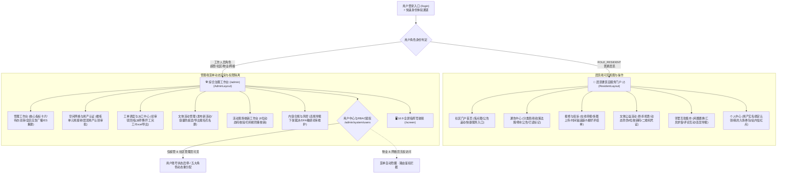
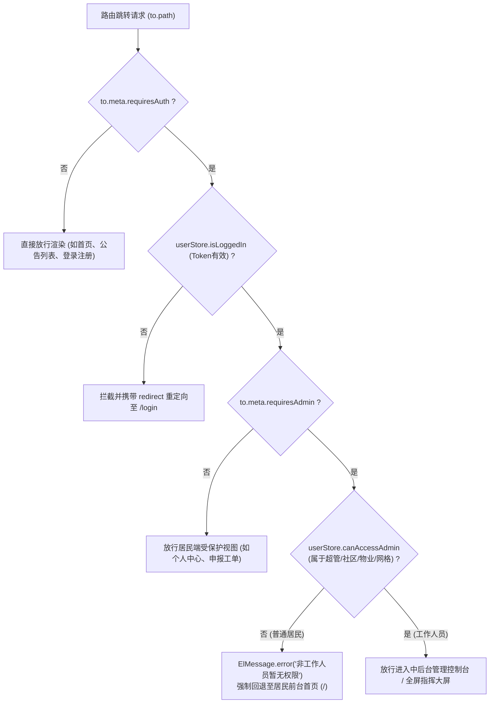

# 智慧社区综合事务管理系统 (前端工程)

> **本科毕业设计选题**：《基于SpringBoot的社区综合事务管理系统的设计与实现》  
> **工程定位**：采用单仓双门户（Dual-Portal）与 16:9 独立指挥大屏架构，整合居民便民自服务门户、中后台综合事务治理控制台与科技感全屏数据驾驶舱。

---

## 一、 系统架构与三大门户形态

前端项目基于 **Vite 6 + Vue 3.5 + TypeScript + Element Plus + Pinia + ECharts** 构建，实现统一权限中枢与无缝多端交互体验：

```mermaid
graph TD
    User["访问入口"] --> Router["Vue Router 4 动态路由守卫"]

    Router -->|居民访客/常规认证| ResidentPortal["🏡 居民前台便民门户 (ResidentLayout)"]
    Router -->|管理员/网格员/物业| AdminConsole["🛠️ 综合治理控制台 (AdminLayout)"]
    Router -->|独立全屏路由| CommandScreen["🖥️ 16:9 综合治理全屏指挥大屏"]

    subgraph ResidentViews ["居民端核心视图"]
        ResidentPortal --> R1["社区门户首页 (公告头条/快捷报修/热搜推荐)"]
        ResidentPortal --> R2["通知公告中心 (分类检索/已读标记/富文本正文)"]
        ResidentPortal --> R3["报修投诉申报与跟踪 (多图上传/工单时间轴/五星评价)"]
        ResidentPortal --> R4["文体公益活动报名 (实时名额进度/动态签到核销码)"]
        ResidentPortal --> R5["邻里集市与互助 (二手转让/求助/借物/点赞评论)"]
        ResidentPortal --> R6["居民个人中心 (房产认证绑定/入场券包/站内信箱)"]
    end

    subgraph AdminViews ["管理端核心视图"]
        AdminConsole --> A1["综合管理工作台 (运营卡片/待办流转/全区广播/ES重建)"]
        AdminConsole --> A2["网格空间与房产认证 (小区/楼栋/单元/房屋树/产证审批)"]
        AdminConsole --> A3["工单流转与派单处置 (初审/派工师傅/完工登记/Excel导出)"]
        AdminConsole --> A4["文体活动与现场核销 (活动发布/花名册导出/6位防伪扫码核验)"]
        AdminConsole --> A5["内容风控与词库治理 (违规举报裁决/DFA前缀树实时同步)"]
        AdminConsole --> A6["用户中心与RBAC赋权 (五大角色调整/账号启停/信用分审计)"]
    end

    subgraph ScreenViews ["大屏可视化组件"]
        CommandScreen --> S1["核心 KPI 动态指标 (常住人口/入住率/办结率/满意度)"]
        CommandScreen --> S2["工单问题分类分布环图 (ECharts Donut)"]
        CommandScreen --> S3["楼栋网格报修热力排行柱状图 (ECharts Bar)"]
        CommandScreen --> S4["社区五维治理活力雷达图 (ECharts Radar)"]
        CommandScreen --> S5["工单全链路状态流转漏斗 (ECharts Funnel)"]
        CommandScreen --> S6["实时动态综合治理事件流 (Live Event Stream)"]
    end
```



---

## 二、 前端核心技术栈清单

| 技术维度 | 选型组件 / 库 | 版本 | 应用场景与设计考量 |
|---|---|---|---|
| **构建工具** | Vite | 6.0.7 | 毫秒级极速热重载 (HMR) 与 Rollup 现代化代码分包 |
| **前端框架** | Vue 3 | 3.5.13 | 全面采用 `<script setup>` 组合式 API (Composition API) |
| **类型系统** | TypeScript | 5.7.2 | 全局接口 DTO/VO 强类型定义与类型安全校验 (`vue-tsc`) |
| **UI 组件库** | Element Plus | 2.9.3 | 中后台标准化表格、级联选择器、抽屉、时间轴与弹窗控件 |
| **状态管理** | Pinia | 2.3.1 | 用户会话 Token 持久化、角色状态响应式派生与权限计算 |
| **图表可视化** | Apache ECharts | 5.6.0 | 支撑 16:9 全屏指挥驾驶舱与工作台环图、漏斗、雷达与柱状图 |
| **即时通讯** | @stomp/stompjs + SockJS | 7.0.0 / 1.6.1 | WebSocket 长连接订阅 `/user/queue/notify` 与 `/topic/emergency` |
| **网络请求** | Axios | 1.7.9 | 统一请求拦截注入 Bearer Token、统一错误捕获与 401 自动回退 |

---

## 三、 目录工程结构说明

```
community-affairs-vue/
├── pnpm-workspace.yaml            # pnpm v11 依赖构建权限配置
├── package.json                   # 项目依赖与运行脚本
├── tsconfig.json                  # TypeScript 编译配置
├── vite.config.ts                 # Vite 配置文件 (代理 /api 与 /ws 至 8082 端口)
└── src/
    ├── main.ts                    # 应用启动入口 (挂载 Pinia, Router, Element Plus)
    ├── App.vue                    # 根组件
    ├── style.css                  # 全局 CSS 变量 (科技蓝与墨色治理基色、卡片阴影)
    ├── types/
    │   └── index.ts               # 全局数据模型与接口规范 (WorkOrder, Activity, ScreenData等)
    ├── utils/
    │   ├── request.ts             # Axios 实例、请求拦截器与全局响应状态机
    │   └── websocket.ts           # STOMP 客户端封装、断线重连与主题订阅
    ├── stores/
    │   ├── user.ts                # 用户登录态、RBAC 角色权限与登出逻辑
    │   └── notice.ts              # 实时消息队列与未读红点计数器
    ├── router/
    │   ├── index.ts               # 路由表定义 (居民门户、管理后台、全屏大屏)
    │   └── guard.ts               # 全局路由守卫 (JWT 鉴权拦截与管理员权限验证)
    └── views/
        ├── auth/                  # 登录与实名注册
        │   ├── LoginView.vue      # 登录页 (含 5 大角色一键免密体验通道)
        │   └── RegisterView.vue   # 新居民在线实名注册
        ├── resident/              # 居民端自服务便民门户
        │   ├── layout/ResidentLayout.vue
        │   ├── home/HomeView.vue
        │   ├── notice/            # 通知公告中心与详情
        │   ├── order/             # 报修与投诉工单申报、跟踪、评价
        │   ├── activity/          # 活动浏览、在线报名与动态二维码入场券
        │   ├── market/            # 邻里集市、物品借用与互动评论
        │   └── user/UserProfileView.vue # 居民个人中心 (房产认证与站内信)
        ├── admin/                 # 综合事务治理中后台
        │   ├── layout/AdminLayout.vue   # 后台侧边栏布局与大屏快速跳转
        │   ├── dashboard/DashboardView.vue # 工作台首页与 ES 索引一键重建
        │   ├── grid/GridManageView.vue    # 空间网格台账与房产认领审批
        │   ├── order/OrderManageView.vue  # 工单调度、师傅指派与Excel导出
        │   ├── activity/ActivityManageView.vue # 活动发布与名单导出
        │   ├── activity/VerifyScanView.vue     # 现场扫码与动态码核销签到台
        │   ├── moderation/ReportManageView.vue # 违规举报处理
        │   ├── moderation/WordManageView.vue   # DFA 敏感词库与前缀树维护
        │   └── system/UserManageView.vue       # 用户中心与 RBAC 赋权
        └── screen/
            └── CommandScreenView.vue  # 16:9 沉浸式科技感全屏指挥大屏驾驶舱
```

---

## 四、 本地开发与构建部署

### 1. 安装项目依赖
本项目使用 `pnpm` 作为包管理工具：
```bash
cd /Users/li/Code/JS/VueProjects/community-affairs-vue

# 安装依赖
pnpm install

# 授权构建脚本 (pnpm v11 规范)
pnpm approve-builds --all
```

### 2. 启动前端开发调试服务器
```bash
pnpm dev
```
启动成功后访问本地地址：
- **前台门户入口**：`http://localhost:5174/`
- **后台控制台入口**：`http://localhost:5174/admin`
- **16:9 全屏指挥驾驶舱**：`http://localhost:5174/screen`
- **用户登录认证中心**：`http://localhost:5174/login`

> **本地代理转发机制**：开发服务器通过 `vite.config.ts` 自动将 `/api` 请求与 `/ws` WebSocket 握手代理转发至后端 `http://localhost:8082`。

### 3. 生产打包构建与类型校验
```bash
pnpm run build
```
执行通过 `vue-tsc -b` 进行严格的 TypeScript 语法与类型校验，并在 `dist/` 目录下生成静态生产资源。

---

## 五、 五大人员角色差异化定位与前端权限全景对比

系统登录界面 (`/login`) 预置了**一键免输入快速角色切换通道**（对应快速身份体验通道），支持答辩与演示时毫秒级切换五大角色，直观呈现不同身份在**路由拦截、菜单展现、按钮级操作及多门户路由**上的严格权限隔离：



---

### 1. 快速身份体验通道 (答辩测试免输入预设账号)

登录页卡片上方内嵌快捷切换器，点击对应身份胶囊即可一键填入凭据：

| 体验胶囊标识 | 角色中文名 | 用户名 | 默认密码 | 角色职能定位 | 登录后默认重定向路径 |
|---|---|---|---|---|---|
| 👑 | **系统管理员** | `admin` | `123456` | 全局超管、系统运维、用户赋权与风控词库 | `/admin/dashboard` (管理工作台) |
| 🏛️ | **社区管理员** | `community_admin` | `123456` | 居委会行政统筹、应急广播发布、活动策划、大屏视察 | `/admin/dashboard` (管理工作台) |
| 🛠️ | **物业管理员** | `property_admin` | `123456` | 物业调度中心、工单初审与派工师傅、物业停水通知 | `/admin/dashboard` (管理工作台) |
| 📋 | **楼栋网格员** | `grid_officer` | `123456` | 责任楼栋长、房产实名认证审批、活动现场扫码签到 | `/admin/dashboard` (管理工作台) |
| 🏡 | **普通居民** | `resident` | `123456` | 社区常住住户、报修申报跟踪、活动秒杀、邻里互助 | `/` (居民便民门户首页) |

---

### 2. 五大角色前端功能与界面权限全景对比矩阵

| 前端模块 / 视图路由 | 功能与界面交互明细 | 👑 系统管理员 | 🏛️ 社区管理员 | 🛠️ 物业管理员 | 📋 楼栋网格员 | 🏡 普通居民 |
|---|---|:---:|:---:|:---:|:---:|:---:|
| **居民门户首页** (`/`) | 社区横幅公告头条、便民服务快捷卡片、热搜榜单 | ✅ 允许访问 | ✅ 允许访问 | ✅ 允许访问 | ✅ 允许访问 | ✅ 主服务视图 |
| **通知公告列表/详情** (`/notices`) | 查阅通告正文、分类筛选、未读红点标记 | ✅ 允许 | ✅ 允许 | ✅ 允许 | ✅ 允许 | ✅ 允许 |
| **在线报修与投诉申报** (`/orders/submit`) | 填写事项、选择楼栋房室、上传多图、加急勾选 | ✅ 允许 | ✅ 允许 | ✅ 允许 | ✅ 允许 | ✅ **核心申报端** |
| **我的工单与评价结单** (`/orders`, `/orders/:id`) | 查看个人申报工单流转时间轴、完工 5 星好评结单 | ✅ 允许 | ✅ 允许 | ✅ 允许 | ✅ 允许 | ✅ **评价奖励积分** |
| **社区活动报名** (`/activities`, `/activities/:id`) | 查看活动详情、秒杀抢票、生成 6 位动态防伪二维码 | ✅ 允许 | ✅ 允许 | ✅ 允许 | ✅ 允许 | ✅ **高并发抢票** |
| **邻里互助与集市** (`/market`, `/market/:id`) | 发布二手闲置/求助借物、互动评论、点赞收藏、举报 | ✅ 允许 | ✅ 允许 | ✅ 允许 | ✅ 允许 | ✅ **邻里互动端** |
| **居民个人中心** (`/user/profile`) | 提交房产认证申请、查看入场券卡包、查阅站内信箱 | ✅ 允许 | ✅ 允许 | ✅ 允许 | ✅ 允许 | ✅ **个人资产中心** |
| **综合治理工作台** (`/admin/dashboard`) | 统计大卡片（报修率/在册人口）、待办工单流转处置列表 | ✅ 全权操作 | ✅ 全权操作 | ✅ 派单处置 | ✅ 初审流转 | ❌ 拦截禁入 |
| └ 突发应急通告全区广播 | 发布级别为 4 的突发应急通告（WebSocket 全区强弹窗） | ✅ 允许 | ✅ **核心发布者** | ❌ 仅限物业通告 | ❌ 无发布权 | ❌ 无发布权 |
| └ ES 全文索引一键全量重建 | 调用后端重新全量同步 Elasticsearch 9.2 索引库 | ✅ **专属操作** | ❌ 无权 | ❌ 无权 | ❌ 无权 | ❌ 无权 |
| **网格空间与房产认证** (`/admin/grid`) | 查看楼栋/单元/房屋三维台账树、常住与空置状态 | ✅ 查看与配置 | ✅ 查看与统计 | ✅ 调阅维修档案 | ✅ 查看管辖楼栋 | ❌ 拦截禁入 |
| └ 居民房产认领审核 | 比对购房协议/租赁合同佐证材料，执行【通过/驳回】 | ✅ 允许 | ✅ 监督审核 | ❌ 无审批权 | ✅ **核心审核人** | ❌ 无权 |
| **工单流转与调度中心** (`/admin/orders`) | 工单多维度组合检索（状态/紧急度/类型/楼栋） | ✅ 允许 | ✅ 允许 | ✅ 允许 | ✅ 允许 | ❌ 拦截禁入 |
| └ 初审工单派单 / 驳回 | 待审核状态工单初审，填写初审意见 | ✅ 允许 | ✅ 允许 | ✅ **调度初审** | ✅ **一线初审** | ❌ 无权 |
| └ 指派/改派维修师傅 | 录入指派技师姓名与联系电话 | ✅ 允许 | ✅ 允许 | ✅ **核心派单权** | ❌ 无指派权 | ❌ 无权 |
| └ 师傅开工与完工登记 | 维修师傅接单、登记完工说明与修复验收照片 | ✅ 允许 | ❌ 无权 | ✅ **录入完工** | ❌ 无权 | ❌ 无权 |
| └ 工单记录 Excel 导出 | 基于 EasyExcel 导出全区工单台账与时效明细 | ✅ 允许 | ✅ 允许 | ✅ **核心导出人** | ❌ 无导出权 | ❌ 无权 |
| **文体公益活动管理** (`/admin/activities`) | 发布新活动、把控容量配额、导出报名花名册 Excel | ✅ 允许 | ✅ **核心统筹者** | ❌ 无发布权 | ❌ 无发布权 | ❌ 拦截禁入 |
| **现场扫码核销签到台** (`/admin/verify`) | 录入 6 位动态凭证码或扫码枪扫码，防伪签到防重核销 | ✅ 允许 | ✅ 允许 | ❌ 无权 | ✅ **现场值守人** | ❌ 拦截禁入 |
| **违规举报与内容合规** (`/admin/moderation/reports`) | 受理邻里违禁违规举报，执行【违规下架】或【驳回】 | ✅ 允许 | ✅ 监督裁决 | ❌ 无权 | ✅ **实地核验裁决**| ❌ 拦截禁入 |
| **DFA 敏感词库管理** (`/admin/moderation/words`) | 检索敏感词列表、添加新拦截词、移除词条 | ✅ **专属维护** | ❌ 无权 | ❌ 无权 | ❌ 无权 | ❌ 拦截禁入 |
| **用户中心与 RBAC 赋权** (`/admin/system/users`) | 检索全量用户、切换账号启停状态、动态重设用户角色 | ✅ **核心管理者** | ✅ 协同查看与管理 | ❌ **菜单隐藏拦截**| ❌ **菜单隐藏拦截**| ❌ 拦截禁入 |
| **16:9 全屏指挥大屏** (`/screen`) | ECharts 环图、漏斗图、雷达图、报修热力排行榜动态看板 | ✅ 科技感大屏 | ✅ **指挥调度大屏** | ✅ 监控大屏 | ✅ 监控大屏 | ❌ 拦截禁入 |

---

### 3. 五大角色前端交互与业务体验深度剖析

#### 👑 角色一：系统超级管理员 (admin)
- **前台感知**：登录后自动导向 `/admin/dashboard`，顶栏显示专属角色徽标 `超级管理员工作台`。
- **界面特权**：
  - 拥有左侧侧边栏**全量可见菜单项**（包括敏感的 `用户中心与RBAC赋权` 及 `DFA敏感词过滤库`）；
  - 工作台 Banner 栏展示独有的 `重建 ES 全文索引` 按钮，点击触发全局索引重构；
  - 可在用户管理页随意切换任一居民的账号状态（正常/停用），并可将其在五大角色间平滑流转。

#### 🏛️ 角色二：社区管委会管理员 (community_admin)
- **前台感知**：登录后导向管理控制台，顶栏标识为 `社区管委会协同台`，主要服务于党群政务与宏观治理。
- **界面特权**：
  - 工作台 Banner 栏常驻 `发布全区紧急通告` 红色按钮，弹窗勾选 `突发应急广播 (全区强提醒)` 后，可通过 WebSocket 向全区正在访问门户的居民下发全屏通告；
  - 在 `社区文体活动管理` 界面作为活动发起方，自由创建诸如“百家宴”、“急救技能公益讲座”等品牌活动，并一键导出报名花名册；
  - 侧边栏及顶栏常驻 `🖥️ 16:9 全屏指挥驾驶舱` 入口，支持在指挥大厅投影展示可视化数据驾驶舱。

#### 🛠️ 角色三：物业调度管理员 (property_admin)
- **前台感知**：登录后导向管理控制台，顶栏标识为 `物业调度管理中心`，侧重工程维保闭环。
- **界面特权**：
  - **菜单针对性裁剪**：侧边栏自动隐藏 `用户中心与RBAC赋权`，确保物业人员无法越权修改系统用户权限；
  - **工单中心核心操盘手**：在 `工单流转与派单处置` 界面拥有最完整的工单动作按钮，包括待审核阶段的“初审派单”、待接单阶段的“接单施工”、施工中的“完工登记”（支持上传维修后现场照片凭证），以及导出工单台账 Excel；
  - 可发布物业类专项通告（如二次供水消杀清洗停水通知、电梯例行维保通知）。

#### 📋 角色四：楼栋网格员 (grid_officer)
- **前台感知**：登录后导向管理控制台，顶栏标识为 `网格联络员终端`，专注基层第一线微服务。
- **界面特权**：
  - **房产实名审核第一责任人**：进入 `网格空间与房产认证`，在“居民房产认领审批”标签页直观查看居民上传的购房协议或租赁合同缩略图，点击放大预览无误后一键“通过认证”或“驳回”；
  - **活动现场扫码工作台**：进入 `现场扫码核销签到` 页面，在活动举办现场通过大输入框接收手持扫描枪或手动键入的 6 位动态码，系统毫秒级反馈签到成功与居民实名卡片；
  - 拥有网格内微小报修的第一道现场勘验初审权限，以及邻里违规举报的实地调查裁决权限。

#### 🏡 角色五：社区常住居民 (resident)
- **前台感知**：登录后直接进入 `🏡 居民便民自服务门户` (`/`)，享受舒适的极简生活服务风界面。
- **界面特权与保护**：
  - **前台完整服务闭环**：在首页查看热搜推荐、浏览政策与物业通告、在线申报报修（带故障拍照、加急标记）、参与文体公益活动秒杀抢票、在邻里集市发帖转让闲置或求借工具；
  - **工单结单激励**：工单完工后在详情页提供 5 星满意度打分与反馈，提交后系统直接提示“已为您增加 5 点社区互助信用分”；
  - **活动动态入场券包**：报名成功的活动自动生成含 6 位专属防伪核销码与 Base64 二维码入场凭证，可在个人中心随时出示供网格员现场核销；
  - **严格的安全隔离**：若居民尝试直接在浏览器地址栏手动输入 `/admin` 或 `/screen`，全局路由守卫 (`guard.ts`) 将即时拦截并弹出 Element Plus 警示通知：“您的账号角色非工作人员，暂无权限进入管理控制台”，并安全回退至居民门户首页。

---

### 4. 前端动态路由与角色守卫鉴权逻辑 (Vue Router Guard)


